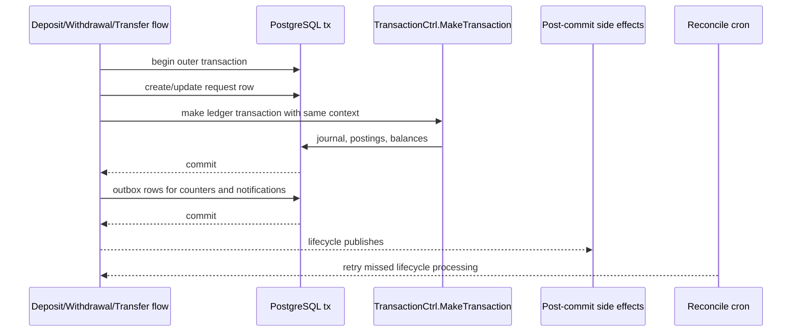
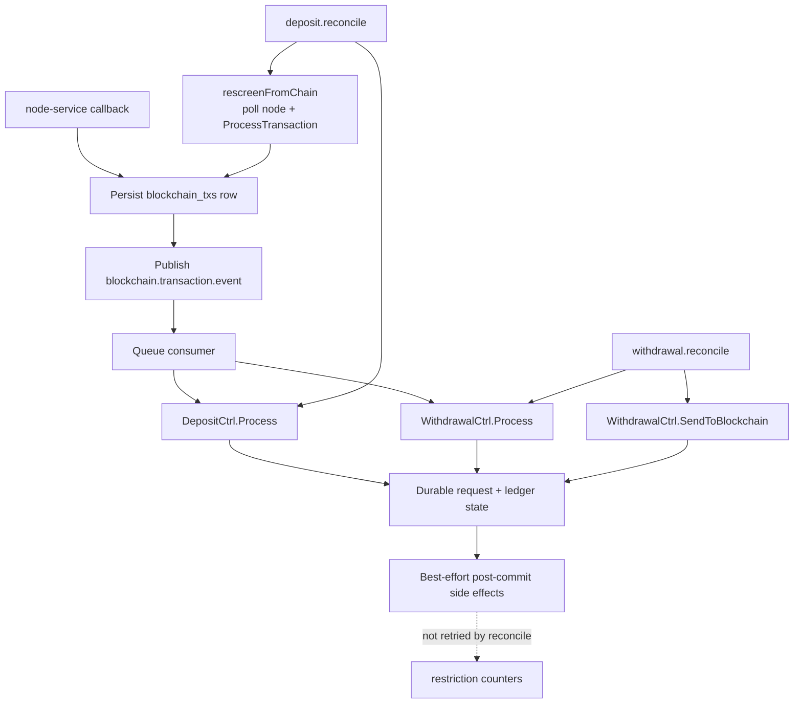

# Account Service

## Overview

`account-service` is the app backend service responsible for wallet and ledger
operations. It owns user and system accounts, balance mutations, transaction
journaling, deposit and withdrawal request flows, transfer flows, blockchain
transaction tracking, balance history snapshots, and related event publishing.

Within the backend group, this repository is also a strong reference
implementation for current Go service structure and coding style.

## What the service owns

- user and system accounts
- balances and integrity protection for balance updates
- journal entries and transaction state
- deposit, withdrawal, and transfer request lifecycle
- blockchain address assignments, chain configs, and blockchain transaction tracking
- balance history snapshots and PnL calculations
- outbound push and lifecycle events related to account operations

## Repository map

| Path | Purpose |
| --- | --- |
| `cmd/account-service` | Main runtime entrypoint, startup orchestration, graceful shutdown. |
| `cmd/account-service/app` | Composition root: wires DB, cache, queue, HTTP client, transports, cron, and `Core`. |
| `cmd/commands/migrate` | Standalone database migration command; applies this repository's migrations plus the shared `outbox_messages` DDL from `common`. |
| `config` | Env-driven runtime configuration for app, DB, HTTP, gRPC, queue, logger, tracer, cron, and KYT providers. |
| `data/db/migrations/postgres` | PostgreSQL schema migrations owned by this service. `outbox_messages` is deliberately not here — see "Transactional outbox". |
| `internal/domain` | Domain entities, enums, DTOs, contracts, cache keys, and service interfaces. |
| `internal/domain/errors` | Service-specific error templates and error contract notes. |
| `internal/controllers` | Use-case orchestration and transaction boundaries. |
| `internal/infrastructure/db/postgres` | GORM/PostgreSQL repositories. |
| `internal/infrastructure/security` | Account integrity protection based on HMAC signatures. |
| `internal/transport/http` | Gin handlers, request validation, HTTP helpers, Swagger annotations. |
| `internal/transport/grpc` | gRPC service implementation and generated protobuf bindings. |
| `internal/transport/queue` | RabbitMQ consumer handlers. |
| `internal/transport/outbox` | Outbox delivery handlers, one per `event_type`. |
| `services/node` | Service-specific HTTP client for the node/blockchain service. |
| `services/kyt/amlbot` | Service-specific HTTP client for AMLBot KYT checks. |
| `tools` | Metrics helpers and transport-related utilities. |
| `docs` | Generated Swagger/OpenAPI artifacts. |

## Runtime architecture

### Composition root

`cmd/account-service/app` is the runtime assembly layer.

`Application.SetupDependencies()` initializes:

1. PostgreSQL connection
2. DB transaction manager
3. RabbitMQ connections
4. Ristretto global local cache
5. Hazelcast remote cache
6. remote cache manager
7. shared outbound HTTP client

`Application.SetupStartupData()` then initializes:

1. Prometheus metrics registration
2. queue manager
3. queue publishers
4. `Core` with repositories, controllers, caches, security, and service clients
5. default system accounts
6. default blockchain chain configs
7. queue consumers
8. HTTP server
9. gRPC server
10. cron manager

At runtime, `main.go` starts queue consumers, cron jobs, the HTTP server, and the
gRPC server under graceful shutdown control. Shutdown also closes queue
publishers/consumers, queue connections, tracer resources, and outgoing gRPC
client connections.

### Core structure

`Core` wires together:

- controllers: `AccountCtrl`, `TransactionCtrl`, `DepositCtrl`, `WithdrawalCtrl`, `TransferCtrl`, `HistoryCtrl`, `BlockchainCtrl`, `EventCtrl`, `CacheCtrl`
- PostgreSQL repositories for accounts, journal entries, transactions, histories, chain configs, address assignments, deposit requests, withdrawal requests, transfer requests, and blockchain transactions
- cache repositories for assets and chain configs
- distributed lockers for deposit, withdrawal, and transfer flows
- integrity guard for account balance protection
- outbound service clients for currency, user, restriction, node, and KYT providers
- outgoing gRPC clients for user and restriction services

### Main architectural layers

- `internal/domain` owns business types, service contracts, cache keys, enums, and shared business helpers.
- `internal/controllers` orchestrate use cases, transactions, locking, and cross-dependency flow.
- `internal/infrastructure/db/postgres` persists state and maps SQL models to domain models.
- `internal/transport/*` translates HTTP, gRPC, and queue traffic into controller calls.
- `services/*` contains service-specific outbound integration code that should not be pushed into `common` unless it becomes genuinely reusable across services.

### Account operation consistency model

Deposit, withdrawal, and transfer flows keep account-service-owned state inside
one PostgreSQL transaction: request rows, journal entries, postings, and balance
updates commit or roll back together. `TransactionCtrl.MakeTransaction` owns a
DB transaction only for standalone calls; when a controller flow already placed a
GORM transaction in `context.Context`, it joins that transaction instead of
opening and committing a nested one.



This means local deposit, withdrawal, and transfer flows do not publish
`transaction.rollback.request` to compensate for account-service DB failures:
before commit, the request and ledger write are rolled back together; after
commit, the ledger is already durable.

Cross-service effects split into two classes.

**Durable.** Restriction counter updates and push notifications are written to
`outbox_messages` *inside* the business transaction and delivered afterwards by
the outbox pool. They commit with the ledger or not at all, and a crash between
commit and delivery loses nothing — the row is still there. See "Transactional
outbox" below.

**Best-effort.** Lifecycle queue publishes remain post-commit calls whose errors
are logged. They are recoverable by other means: reconciliation jobs recover
missed lifecycle processing for deposits and withdrawals, including lost
`blockchain.transaction.event` and `withdrawal.request.event` deliveries.

#### What a repeat callback may change

node-service calls back more than once per transaction — confirmations
accumulate — and delivery is at-least-once and unordered, so an older callback
can arrive after a newer one. `BlockchainCtrl.ProcessTransaction` therefore
treats a callback for a known `external_request_id` as an update to an existing
row rather than a fresh description of it.

Only status, confirmations and the transaction hash move. The fields that say
*which* transaction this is — type, asset, network, both addresses, amount — are
fixed once the row exists, and `UpdateStatus` never wrote them anyway. A
callback whose identity fields disagree is refused with `InvalidRequestError`
and logged under `blockchain_tx=identity_mismatch`: it means either a
node-service defect or a forged callback, and previously its status would have
been applied to a row describing a different transfer.

Two things are also held against going backwards:

- a **terminal** status — `Confirmed`, `Failed`, `Ignored`, `Blocked` — is not
  replaced by a non-terminal one. `BlockchainTxStatus.IsTerminal` is what
  decides; the constants' numeric order is not a progression, since
  `PendingSignatures` precedes `Pending` for a multisig withdrawal.
- the confirmation count does not decrease.

Terminal to terminal stays allowed. A reorg that turns a confirmed transaction
into a failed one is real, and recording it is exactly what an operator needs;
neither the deposit nor the withdrawal flow un-credits on it, so suppressing the
update would only hide the event.

#### A missing account is a zero balance

`AccountRepo.GetBalance` returns zero, not an error, when no account row
matches. Accounts are created on demand — by the `user.created` consumer and
lazily by `TransactionCtrl.lockOrCreateAndLockAccount` — so a user without a row
yet has no funds, and zero is the honest answer.

It also has to be the answer the callers can use. Both of them are balance
checks in `WithdrawalCtrl.Init` and `TransferCtrl.Init`, and both map any error
from this call to `DatabaseError`. Reporting not-found here would turn a
legitimate state into a 500 on two money paths instead of a clean
insufficient-funds result.

The zero comes from GORM's `Scan`, which — unlike `First` — reports no error for
an empty result. The method used to carry an unreachable `ErrRecordNotFound`
branch that suggested otherwise; it is gone, and an integration test pins the
behaviour so switching to `First` fails loudly rather than in production.

#### One shared HTTP client, no per-call mutation

`setupHTTPClient` builds one `*req.Client` and `Core.initServices` hands the
same instance to the currency, user, node and KYT clients. It is shared on
purpose — connection pooling, retry policy and tracing instrumentation are
configured once.

Sharing it means it must not be mutated after setup. Every outbound call used to
begin with `client.SetTimeout(...)`, which writes `httpClient.Timeout`; that
field is read by `net/http` on each in-flight request, so two concurrent calls
were an unsynchronised write against a read. `go test -race` reports it as
`req.(*Client).SetTimeout` against `net/http.(*Client).do`.

Per-call bounds now come from the request context via
`commonHTTP.WithCallTimeout(ctx, config.Commons().TimeoutExtCall)`, which leaves
the client untouched. A non-positive duration means "no per-call bound", the
same thing `SetTimeout(0)` meant — wrapping with a zero timeout would hand back
an already-expired context and fail every request.

The client-level timeout set in `setupHTTPClient` stays as the backstop.

#### One lock order for account rows

Every path that takes row locks on `accounts` orders them through
`controllers.sortAccountLookups`, on the key `(owner, asset, type)` — which is
UNIQUE on the table, so it is a total order.

This is an invariant, not a preference. Two paths locking the same rows in two
orders deadlock, and PostgreSQL resolves that by aborting one transaction with
SQLSTATE `40P01` — not something the caller chose or can steer.

`RollbackTransaction` is the path that makes this easy to get wrong: the
postings hand it account ids, so locking by primary key is the obvious move, and
it was what the code did. Primary key order agrees with `(owner, asset, type)`
order only while account ids are created in owner order — true for accounts
created at registration, false for any account created lazily at first use. So
`lockAccountsForReversal` reads the rows unlocked first, purely to learn their
lookup keys, and then locks them in the shared order. The unlocked read is safe
for that: accounts are never deleted, and every value used afterwards comes from
the locked read.

`AccountRepository.GetByIDsForUpdate` still locks by id. It is only reachable
from a caller that has already fixed the order, and adding a second caller means
picking up the ordering problem again.

#### Resending a withdrawal to the blockchain

`WithdrawalCtrl.SendToBlockchain` calls node-service *before* opening its own DB
transaction, so a withdrawal can be broadcast while its local transaction still
fails to commit. That is what the stuck-New reconcile pass is for, and it works
because node-service is idempotent on the withdrawal idempotency key: a resend
returns the original `request_id` instead of broadcasting again.

`BlockchainCtrl.Withdrawal` therefore looks the request id up before inserting.
`blockchain_txs.external_request_id` is unique, so a blind insert on the resend
path would fail and leave the withdrawal at `New` forever, failing identically on
every reconcile tick. When the row already exists it is reused as-is: nothing is
written, because `ProcessTransaction` backfills `tx_id` when the callback
arrives and `PollTransactionStatus` falls back to the request id while the hash
is unknown. A row that is inbound or points at another address is refused rather
than adopted — settling a withdrawal against an unrelated transaction is worse
than failing loudly.

#### KYT verdicts

AMLBot reports three outcomes, and only `success` is a usable verdict: the
provider answers HTTP 200 with `result:false` on its own internal errors, and
reports a still-running check as `pending`. Both decode to a non-success status
where `IsClean` carries no information.

`KYTCheckAddressResult.Verdict()` reduces the reply to a `KYTVerdict`, and
`KYTVerdict.PermitsCredit()` is the allow-list that guards the crediting path:
only a clean check and `NotChecked` — the outbound case, screened once before
the funds are sent — permit it. The zero value is deliberately not a verdict, so
a caller that forgets to classify an address holds instead of paying out.

An undecided verdict is never treated as clean:

- **Withdrawal.** `SendToBlockchain` does not broadcast and returns
  `KYTVerdictUnavailableError`. The request stays `New`, so the consumer retry
  budget and the stuck-New reconcile pass both re-run the check once the
  provider answers. The user is not blocked — that is reserved for an actual
  flagged verdict.
- **Inbound transaction.** `ProcessTransaction` holds the transaction below
  `Confirmed`, at `Pending`. `Confirmed` is the status the deposit flow credits
  on, so the deposit request is created or left at `Pending` and no balance
  moves.

  The hold is lifted by any later `ProcessTransaction` call for the same
  `external_request_id` — a further node-service callback, or the deposit
  reconcile cron, which re-screens each stuck row through
  `DepositCtrl.rescreenFromChain` before advancing it. The re-screen polls
  node-service first and puts *that* status through `ProcessTransaction`: the
  stored row carries account-service's own capped `Pending` rather than the
  chain's answer, so re-deriving a status from it would only cap a second time
  and the hold could never clear. The poll is best effort — when node-service is
  unreachable the tick still runs `Process`, which is what recovers a lost
  `blockchain.transaction.event`.

Both paths are alertable as themselves rather than as a node-service failure:
`screenSender` logs a structured `kyt=<verdict>` field, and
`WithdrawalCtrl.reconcileNewOne` logs `outcome=kyt_inconclusive` — kept distinct
from its `node_unreachable` branch on purpose.

### Transactional outbox

The mechanism is `github.com/whagency/core-common/outbox`, shared with
`pay-service`. Design, tuning, throughput numbers, and failure modes are
documented once in `repos/shared/common/outbox/README.md` and
`ARCHITECTURE.md` (Russian versions alongside); this section only records what is
specific to account-service.

Current event types:

| `event_type` | Written by | Delivered to |
|---|---|---|
| `restriction.counter.update` | deposit, withdrawal, transfer flows | restriction-service gRPC |
| `notification.push` | account operation flows | notification queue |

Schema ownership: the `outbox_messages` DDL is **not** in
`data/db/migrations/postgres`. `cmd/commands/migrate` applies it from
`github.com/whagency/core-common/outbox/postgres/migrations` as a second source
against its own history table, `schema_migrations_common`. Two sources cannot
share one history table — they would fight over the version counter — so shared
migrations are numbered from a reserved `9_000_000+` band.

The migrate command targets both sources by default for `up` and `version`.
`down`, `steps`, `force`, and `drop` carry a step count or version number that
means something to exactly one history table, so they default to this
repository's schema only; pass `-source=common` to aim them at the shared one.

Configuration is `outbox.Settings`, nested in `config.CronSettings` as `Outbox`
and read from `CRON_OUTBOX_*`. The defaults are shared with pay-service on
purpose: both services publish identical metric names, so one dashboard and one
alert set describe both — but only while the numbers agree.

## Interfaces and integrations

### HTTP API

The HTTP API is mounted under `/api/v1`.

User-session protected account endpoints:

- `GET /api/v1/accounts/get-balances`
- `GET /api/v1/accounts/get-pnl`
- `POST /api/v1/accounts/deposits/init`
- `POST /api/v1/accounts/withdrawals/init`
- `POST /api/v1/accounts/transfers/init`

User-session protected history endpoints:

- `GET /api/v1/history/transactions`
- `GET /api/v1/history/deposits`
- `GET /api/v1/history/withdrawals`
- `GET /api/v1/history/transfers`
- `GET /api/v1/history/deposits/:id`
- `GET /api/v1/history/withdrawals/:id`

User-session protected blockchain endpoints:

- `GET /api/v1/blockchain/fees/:network/:asset`
- `GET /api/v1/blockchain/configs`

Internal security-token protected endpoints:

- `POST /api/v1/internal/blockchain/webhooks/transaction/process`
- `POST /api/v1/internal/accounts/withdrawals/operations`
- `POST /api/v1/internal/accounts/deposits/operations`
- `POST /api/v1/internal/dev/accounts/topup`
  - local/dev-only internal TopUpUserAccount helper
  - local/dev only
  - requires internal security token
  - available only when `ENABLE_DEV_INTERNAL_ENDPOINTS=true` and the environment is local/dev

Operational endpoints:

- `GET /api/v1/health`
- `GET /api/v1/swagger/*any`

### gRPC API

The gRPC contract is defined in `proto/account/v1/account.proto`.

Current RPCs:

- `MakeTransaction`
- `AutomaticManualApproveDeposits`
- `GetJournalByIdempotencyKey`

`GetJournalByIdempotencyKey` is read-only and exists because `MakeTransaction`
cannot be used to ask whether a posting happened: it returns an existing journal
for a matching idempotency key, but *creates* one when there is no match, so a
caller probing for a posting would create it. pay-service's ledger compensation
cron uses this call to recover a journal id it failed to record locally.

Two properties of the answer matter to callers:

- the stored key is derived from the business type and the caller-supplied key
  together, so the request carries both
- a rolled-back journal is reported as **not found**, because
  `RollbackTransaction` renames the original key to free it for a re-attempt.
  For a caller asking "is there a live posting to compensate?", not-found is the
  correct answer for both a posting that never happened and one already reversed.

The service implementation lives in `internal/transport/grpc/account`, while the
generated bindings live in `internal/transport/grpc/pb/accountv1`.

### Queue integrations

RabbitMQ publishers configured by the service:

- push events
- blockchain transaction lifecycle events
- withdrawal request lifecycle events
- transaction rollback requests for compatibility/manual compensation paths

RabbitMQ consumers configured by the service:

- user created lifecycle events
- blockchain transaction lifecycle events
- withdrawal request lifecycle events
- transaction rollback requests

Queue names, exchanges, routing keys, prefetch counts, and consumer counts are
driven by `config/queue.go`.

#### Retry & DLQ pipeline

All four consumers opt into the platform retry/DLQ pipeline provided by
`common/queue/rabbitmq`. On startup the service idempotently declares a
per-queue retry topology:

- `<queue>.retry` — `x-delayed-message` exchange (wraps `direct`); retries are
  republished here with an `x-delay` header and routed back to the original
  queue after the delay.
- `<queue>.dlq` — fanout exchange and durable parking queue.

Default retry budgets (override via env in `config/queue.go`):

| Queue | MaxRetries | Delays |
|---|---|---|
| `account.user.created` | 5 | 30s, 2m, 10m, 30m, 2h |
| `blockchain.transaction.event` | 7 | 30s, 1m, 5m, 15m, 1h, 2h, 6h |
| `withdrawal.request.event` | 5 | 30s, 2m, 10m, 30m, 2h |
| `transaction.rollback.request` | 7 | 30s, 1m, 5m, 15m, 1h, 2h, 6h |

Set a consumer's `QUEUE_*_RETRY_MAX_RETRIES=0` to disable both retry policy and
startup retry/DLQ topology declaration for that queue; the consumer then falls
back to legacy `NackRequeue` behavior.

Errors are classified as follows:

- handler returns `nil` → ACK
- handler wraps the error with `queue.MarkNonRetryable` (malformed payload,
  validation, `RecordNotFound`, deterministic 4xx from external providers) →
  parked in DLQ with header `x-reason=permanent`
- any other error → republished to the retry exchange with the next delay; if
  retries are exhausted, parked in DLQ with header `x-reason=max_retries_exceeded`

DLQ messages carry observability headers: `x-attempt`, `x-first-failed-at`,
`x-last-error` (truncated), `x-original-routing-key`, `x-reason`.

#### Classification policy by handler

Each consumer handler decides locally which controller errors are
deterministic (→ park immediately) and which are transient (→ retry budget).
The handlers use the shared helper
`internal/transport/queue/handlers/retry_policy.go::discardOnKnownAccountQueueError`,
which marks errors as non-retryable when their `errorsx.ErrorResponse.Code`
matches one of the listed permanent codes, or when the cause chain contains
`domain.ErrRecordNotFound`.

| Handler | Permanent (non-retryable) controller errors | Notes |
|---|---|---|
| `user_lifecycle` | (only payload-level) | `CreateDefaultAccountsForUser` is idempotent at the repo layer (`CreateBatch` uses `ON CONFLICT DO NOTHING`); re-delivery returns `nil` without error, so no controller-level classification is needed. |
| `withdrawal_request_lifecycle` | `RecordNotFoundError`, `InvalidRequestError` | `InvalidRequestError` covers wrong-status re-delivery after the request left `New`. `WithdrawalRequestInProgressError` from locker contention stays retryable. |
| `blockchain_transaction_lifecycle` | `RecordNotFoundError` | `Process` (deposit/withdrawal) does not return `InvalidRequestError`; status guards make it idempotent. `DepositRequestInProgressError` from locker contention stays retryable so the next backoff tick succeeds after the other worker releases the lock. |
| `transaction_rollback` | `RecordNotFoundError`, `InvalidRequestError` | `RollbackTransaction` returns `InvalidRequestError` only for the data-integrity case "no postings found for journal". Status guard `JournalStatusReversed` returns `nil` on re-delivery, so there is no idempotency loop. |

All handlers also mark payload-level errors (malformed JSON, missing required
fields, unexpected message type, unsupported tx type) as non-retryable —
these are deterministic format failures that retrying cannot fix.

#### Idempotency providers per handler

Each handler relies on a different mechanism to make re-delivery safe.
This matters because the retry pipeline can deliver the same message up to
`MaxRetries+1` times under failure, plus once more on consumer crash recovery.

| Handler | Idempotency provider | Where |
|---|---|---|
| `user_lifecycle` | DB `ON CONFLICT DO NOTHING` | `internal/infrastructure/db/postgres/accounts.go::CreateBatch` |
| `withdrawal_request_lifecycle` | (1) Hazelcast `processingLocker` per `withdrawal_request_id`, (2) status guard `Status==New` inside DB tx, (3) node-service idempotency on `withdrawal_request_<id>_<network>_<addr>` (Mongo unique sparse index + lookup-before-send) | `internal/controllers/withdrawal.go::SendToBlockchain` |
| `blockchain_transaction_lifecycle` | Status guard `Status==Pending` for withdrawals, status precedence guard `Status not in {New,Pending}` for deposits, both with `GetByBlockchainID(ForUpdate)` row lock | `internal/controllers/withdrawal.go::Process` and `internal/controllers/deposit.go::Process` |
| `transaction_rollback` | Status guard `JournalStatusReversed` returns `nil` early; row-level `GetByIDForUpdate` lock serializes concurrent deliveries | `internal/controllers/transaction.go::RollbackTransaction` |

If you change a handler or a controller method in the table above, verify
the idempotency provider still holds. The platform retry pipeline assumes
all four handlers are safe to invoke twice for the same payload.

#### DLQ runbook

When a money-critical DLQ has depth > 0:

1. **Inspect** the DLQ message via the RabbitMQ management UI
   (`http://localhost:15672`, queue `<queue>.dlq`). Read `x-reason`,
   `x-last-error`, `x-attempt`, and the payload.
2. **Diagnose** the root cause:
   - `x-reason=permanent` → handler classified the error as deterministic.
     Likely a payload bug or a business invariant that needs admin action;
     the message will not retry by itself.
   - `x-reason=max_retries_exceeded` → external dependency was unavailable
     beyond the retry window. Check `node-service`, AMLBot, gRPC dependencies,
     DB locks. The withdrawal/account state in DB will normally still reflect
     the pre-attempt status (e.g. `New`, not `Pending`) thanks to status-machine
     idempotency guards.
3. **Resolve**:
   - For `withdrawal.request.event.dlq`: after the dependency is healthy, call
     the operational endpoint
     `POST /api/v1/internal/accounts/withdrawals/operations` with
     `action=SendToBlockchain` and the original `withdrawal_request_id`. The
     handler is idempotent (status guard + `IdempotencyKey` on node-service),
     so a re-trigger is safe even if the parked message had partially
     succeeded downstream.
   - For `transaction.rollback.request.dlq`: requires manual review by an
     operator with admin access to the journaled transaction state. Normal
     local deposit, withdrawal, and transfer DB failures no longer depend on
     this queue because their request and ledger writes share one transaction.
   - For `blockchain.transaction.event.dlq`: verify the on-chain status of the
     transaction via the blockchain explorer and `node-service`, then
     republish manually if needed.
   - For `account.user.created.dlq`: the user exists in `user-service` but
     default accounts were not created. Resolve by re-publishing the
     `user.created` event from `user-service` (idempotent on this side).
4. **Republish** from DLQ via the management UI ("Move messages" or
   "Get message" → re-publish to the original exchange) only after the root
   cause is fixed; otherwise the message will land back in DLQ.

### Scheduled jobs

The service registers three cron jobs through the shared cron manager:

- `account.pnl.update` -> `AccountCtrl.UpdatePnlStat`
- `withdrawal.reconcile` -> `WithdrawalCtrl.ReconcileStuck`
- `deposit.reconcile` -> `DepositCtrl.ReconcileStuck`

Lifecycle recovery boundary:



#### Withdrawal reconciliation cron

`withdrawal.reconcile` is the recovery path for withdrawals stuck because their
queue message died (DLQ-parked, or lost between callback and consumer). DLQ
visibility is not by itself recovery — this cron closes that gap automatically.
It recovers withdrawal lifecycle progress; it does not retry best-effort
restriction counter side effects that failed after commit.

Each tick runs two passes; per-record errors are logged and counted but never
abort the tick.

**Pass 1 — stuck Pending → poll node-service.** For withdrawals that have been
`Pending` longer than `CRON_WITHDRAWAL_RECONCILE_PENDING_THRESHOLD` (default
`30m`), polls `node-service` for the latest status. If local `blockchain_txs.tx_id`
is known, it uses `GET /api/wallet/transaction-status/:txid`; if the withdrawal
is still in multisig pre-broadcast state and the hash is not known yet, it uses
`GET /api/wallet/transaction-status/by-request/:requestId` with
`BlockchainTx.ExternalRequestID`. When node-service returns a newly-broadcast
`txid`, account-service stores it through `BlockchainCtrl.ProcessTransaction`.
If terminal, the cron also calls `WithdrawalCtrl.Process` to handle the case
where `BlockchainTx` is already at the right status but the withdrawal-side
transition was never applied. Read-only against the chain.

**Pass 2 — stuck New → resend.** For withdrawals that have been `New` longer
than `CRON_WITHDRAWAL_RECONCILE_NEW_THRESHOLD` (default `3h`, deliberately
larger than the default withdrawal queue retry budget of `2h42m30s` so the
cron only takes over after the consumer has had its normal recovery window),
calls `WithdrawalCtrl.SendToBlockchain` — the same method an operator would
invoke. Three layers of safety prevent double-spend: the controller's
`processingLocker` per withdrawal ID, the in-transaction `status==New` guard,
and node-service idempotency on `withdrawal_request_<id>_<network>_<addr>`
(Mongo unique sparse index on `Transaction.requestId` + lookup-before-send).
A duplicate call returns the existing `txid` without a second on-chain
submission.

**Bounded batch.** Each pass processes at most
`CRON_WITHDRAWAL_RECONCILE_BATCH_SIZE` (default `50`) records per tick. Records
are scanned ascending by id so the oldest stuck withdrawals are recovered first.

**Configuration:**

| Envvar | Default | Purpose |
|---|---|---|
| `CRON_WITHDRAWAL_RECONCILE_SPEC` | `@every 5m` | Cron schedule. |
| `CRON_WITHDRAWAL_RECONCILE_PENDING_THRESHOLD` | `30m` | Min age before Pass 1 picks up a Pending withdrawal. |
| `CRON_WITHDRAWAL_RECONCILE_NEW_THRESHOLD` | `3h` | Min age before Pass 2 picks up a New withdrawal. Keep > withdrawal queue retry total. |
| `CRON_WITHDRAWAL_RECONCILE_BATCH_SIZE` | `50` | Max records per pass per tick. |

**Observability (structured logs):**

Each reconcile action emits a structured log event with fields
`reconcile=withdrawal`, `pass=<pending|new>`, `withdrawal_id=<id>`, and
`outcome=<result>`. Use Grafana Loki to query and alert on these events.

| outcome | pass | level | meaning |
|---------|------|-------|---------|
| `recovered` | `pending` | INFO | withdrawal advanced to terminal state |
| `sent` | `new` | INFO | stuck New withdrawal sent to blockchain |
| `lock_busy` | any | DEBUG | worker or consumer holds lock; next tick retries |
| `status_changed` | `new` | DEBUG | queue consumer advanced the withdrawal first |
| `no_tx_hash` | `pending` | DEBUG | multisig pre-broadcast; waiting for tx_id |
| `node_unreachable` | `pending` | ERROR | node-service call failed |
| `node_unreachable` | `new` | ERROR | node-service rejected the send |
| `db_error` | any | ERROR | database failure |
| `process_tx_error` | `pending` | ERROR | ProcessTransaction failed |
| `process_error` | `pending` | ERROR | Process() failed after ProcessTransaction |
| `send_error` | `new` | ERROR | SendToBlockchain unexpected error |
| `invariant_violation` | `pending` | ERROR | Pending withdrawal with no blockchain_tx_id |
| `query_error` | any | ERROR | stuck-row query failed; entire pass skipped |

**Loki query examples:**

```logql
# count recoveries in last 1h (per pass)
count_over_time({app="account-service"} | json | outcome="recovered" [1h])

# alert: sustained node errors
count_over_time({app="account-service"} | json | outcome="node_unreachable" | reconcile="withdrawal" [15m]) > 5

# alert: invariant violations (require manual review)
count_over_time({app="account-service"} | json | outcome="invariant_violation" [1h]) > 0
```

**Runbook signals:**

- Sustained `outcome=node_unreachable` (ERROR) → `node-service` is degraded;
  the cron will keep trying every tick. Investigate node-service first.
- Sustained `outcome=recovered` or `outcome=sent` (INFO) > 0 → recoveries are
  happening, which means messages are dying somewhere in the pipeline.
  Investigate retry/DLQ consumer health to find the root cause —
  reconciliation is a safety net, not a substitute for a healthy queue path.
- `outcome=invariant_violation` (ERROR) → a Pending withdrawal has no
  `blockchain_tx_id`. Requires manual operator review; the cron skips these.
- `withdrawal=amount_mismatch` (ERROR) → the on-chain amount differs from
  `amount - fee` on the request. Detected, **not** blocking: the ledger settles
  the requested amount either way. See below.

To disable the cron in an emergency, set `CRON_WITHDRAWAL_RECONCILE_SPEC` to a
spec that never fires (e.g. `@every 99999h`); restart the service. The manual
`withdrawals/operations` endpoint remains available as a fallback.

#### Amount mismatch on a completed withdrawal

`WithdrawalCtrl.process` compares `amount - fee` on the request against the
amount recorded on the `BlockchainTx`. A difference is logged with
`withdrawal=amount_mismatch`, carrying `expected`, `on_chain`, and both ids, and
written to the request's `description`. It does not change the outcome: the
withdrawal still settles for the requested amount.

That is deliberate. Parking the request for review would strand it — `resend`
requires status `New`, so this service has no path that could release a
withdrawal held here. The alert is the control, and reconciliation is manual.

The check cannot fire for a `blockchain_txs` row this service created: the
amount is written from the withdrawal request and `UpdateStatus` never touches
it afterwards, so the comparison is against itself. It fires when the row came
from a node-service callback that won the race against
`BlockchainCtrl.Withdrawal` — the one case where the two amounts have
independent origins, and the case the request-id lookup now adopts instead of
failing on the unique index.

```logql
# alert: any amount mismatch (expect zero)
count_over_time({app="account-service"} | json | withdrawal="amount_mismatch" [1h]) > 0
```

#### Deposit reconciliation cron

`deposit.reconcile` recovers two things: deposits whose
`blockchain.transaction.event` message died between the callback webhook and
the consumer, and inbound transactions held below `Confirmed` because the KYT
verdict was not usable at the time of the last callback. It does **not**
discover deposits that never reached account-service (no callback at all) —
that recovery belongs to `node-service`'s monitoring loop and
`transactionCallbackDispatcher`. It also does not retry best-effort restriction
counter side effects that failed after commit.

Each tick runs one pass:

1. Find inbound `blockchain_txs` rows whose age exceeds
   `CRON_DEPOSIT_RECONCILE_THRESHOLD` (default `15m`) and which do **not**
   yet have a `deposit_request` in terminal `Success` state. The exclusion
   keeps the scan focused on actually-stuck rows.
2. Re-screen the row through `DepositCtrl.rescreenFromChain`: poll node-service
   for the chain's current status, then feed that through
   `BlockchainCtrl.ProcessTransaction`, which is the only path that runs the
   address check. This is what releases a KYT hold.
3. Call `DepositCtrl.Process(BlockchainTxID)` — the same method the queue
   consumer uses. Three layers of safety make this idempotent:
   per-`BlockchainTxID` `processingLocker`, the existing "create-or-noop" branch
   (creates `DepositRequest` if missing, no-ops if already at terminal status),
   and the row-level transaction inside `Process`.

Step 2 must poll rather than replay what is stored. A transaction held on an
inconclusive verdict carries account-service's own capped `Pending`, not the
chain's answer, so re-deriving a status from the stored row would apply the cap
to itself and the hold could never clear. Step 2 is also best effort: when
node-service is unreachable the tick still runs step 3, so a node outage costs
the re-screen but never the lost-event recovery.

**Configuration:**

| Envvar | Default | Purpose |
|---|---|---|
| `CRON_DEPOSIT_RECONCILE_SPEC` | `@every 5m` | Cron schedule. |
| `CRON_DEPOSIT_RECONCILE_THRESHOLD` | `15m` | Min age before the cron picks up a candidate row. Safe to run before queue retries finish because `DepositCtrl.Process` is locked and idempotent. |
| `CRON_DEPOSIT_RECONCILE_BATCH_SIZE` | `50` | Max records per tick. |

**Observability (structured logs):**

Each reconcile action emits a structured log event with fields
`reconcile=deposit`, `blockchain_tx_id=<id>`, and `outcome=<result>`.
Use Grafana Loki to query and alert on these events.

| outcome | level | meaning |
|---------|-------|---------|
| `recovered` | INFO | deposit advanced to terminal state |
| `lock_busy` | DEBUG | worker or consumer holds lock; next tick retries |
| `not_found` | WARN | blockchain_tx disappeared between scan and Process |
| `node_unreachable` | WARN | re-screen skipped, node-service did not answer; step 3 still ran |
| `rescreen_error` | ERROR | `ProcessTransaction` failed during the re-screen |
| `db_error` | ERROR | database failure inside Process |
| `process_fault` | ERROR | unexpected error from Process |
| `query_error` | ERROR | stuck-row query failed; entire tick skipped |

**Loki query examples:**

```logql
# count recoveries in last 1h
count_over_time({app="account-service"} | json | outcome="recovered" | reconcile="deposit" [1h])

# alert: sustained process faults
count_over_time({app="account-service"} | json | outcome="process_fault" | reconcile="deposit" [15m]) > 3
```

**Runbook signals:**

- Sustained `outcome=process_fault` (ERROR) → unexpected error from
  `DepositCtrl.Process`. Check logs for the wrapped service error code.
- Sustained `outcome=recovered` (INFO) > 0 → recoveries are happening.
  Investigate the `blockchain.transaction.event` consumer health and DLQ for
  the root cause; reconciliation is a safety net.
- Sustained `outcome=lock_busy` (DEBUG) → the queue consumer or another cron
  tick is keeping up; the cron will retry next tick.

To disable in an emergency: set `CRON_DEPOSIT_RECONCILE_SPEC` to a spec
that never fires and restart. node-service will continue retrying its
callback for newly-detected deposits via its own `transactionCallbackDispatcher`.

### External dependencies

The service depends on:

- PostgreSQL for persistent state
- RabbitMQ for async message flows
- Hazelcast plus Ristretto for remote and local cache layers
- `currency-service` over HTTP
- `user-service` over HTTP and gRPC
- `restriction-service` over HTTP and gRPC
- `node-service` over HTTP
- AMLBot KYT provider over HTTP
- `common` for logging, tracing, HTTP/gRPC middleware, cache/queue helpers, error helpers, and shared service clients

## Data, cache, and integrity model

- PostgreSQL is the only supported DB driver in the current implementation.
- Cache configuration is loaded from `config/cache_manager.yml`.
- `assets` and `chain_configs` are cached and refreshed through cache repositories.
- Balance updates are protected by an HMAC-based integrity check implemented in `internal/infrastructure/security/account_integrity.go`.
- Startup refreshes the assets cache from `currency-service` and chain configs from the DB.

### Reading fee revenue

Fees are recorded as postings, not as a balance. No spec in `TxRegistry` credits
the system revenue account — every fee leg debits the payer and nothing offsets
it — so `accounts` never shows what the platform earned, and the revenue account
created at startup stays at zero. Fee revenue has to be summed from
`transactions` instead.

The obvious query is wrong:

```sql
-- WRONG: double-counts every fee whose journal was rolled back
SELECT SUM(amount) FROM transactions WHERE type = 3;
```

`RollbackTransaction` normalises a reversed `debit`/`credit` leg to the opposite
type, but leaves a `fee` leg as `fee`, and stores the amount as an absolute
value. A reversed fee is therefore the same row shape as a charged one:
`type = 3` with a positive amount. Summing them adds the refund to the charge
instead of cancelling it — a rolled-back transfer of 100 with a fee of 5 reports
10 rather than 0.

Exclude both the reversal entry and the original it reversed:

```sql
SELECT SUM(t.amount)
FROM transactions t
JOIN journal_entries e ON t.journal_id = e.id
WHERE t.type = 3               -- fee
  AND e.reversal_of_id IS NULL -- not a reversal entry
  AND e.status <> 5;           -- not an entry that was reversed
```

Balances are unaffected by this: `applyBalanceDeltas` works from the signed
delta, so a reversal restores the payer's balance correctly. It is only the
posting row that cannot tell a charge from a refund.

## Configuration

Configuration is loaded from environment variables through `config.Init()`.

Important config areas:

- app/common settings: service identity, environment, security token, external URLs, gRPC URLs, timezone
- DB: PostgreSQL connection details, including `DB_SSL_MODE`
- HTTP: server timeouts, retry/backoff settings for outbound requests, port
- gRPC: port, request timeout, stream limits, keepalive
- queue: exchange names, routing keys, consumer counts, reconnect interval
- logger/tracer: shared observability configuration
- cron: schedule configuration, including the outbox pool and retention settings
  (`CRON_OUTBOX_*`, defined in `outbox.Settings`)
- KYT provider settings: AMLBot credentials and endpoint
- local/dev-only helpers: `ENABLE_DEV_INTERNAL_ENDPOINTS`

`NODE_SERVICE_URL` is the node-service origin, without API path. The node client
adds the real node-service wallet paths internally, such as
`/api/wallet/generate-address`, `/api/wallet/gas-fee/:network`, and
`/api/wallet/withdraw`. Use values such as `http://node-service:3000` for the
real node-service or `http://localhost:8099` for the local stub-service.

Use `.env.example` as the starting point for local environment variables.

### Security token and database TLS

`SECURITY_TOKEN` guards this service's `/api/v1/internal` endpoints and
authenticates its own calls to other services' internal endpoints.

The token must not be empty: `config.Init()` fails at startup when it is blank,
because envconfig's `required` tag only rejects an *unset* variable and an empty
token authenticates nothing.

`DB_SSL_MODE` is passed through as the PostgreSQL `sslmode` and accepts
`disable|allow|prefer|require|verify-ca|verify-full`. It defaults to `disable`
for local infrastructure; deployed environments should set at least `require`.
An unrecognised value fails at startup rather than silently downgrading the
connection. The same value is used by `cmd/commands/migrate`.

## Local development

### Prerequisites

- Go version declared in `go.mod` (`go 1.25.8` at the time of writing)
- PostgreSQL
- RabbitMQ
- Hazelcast
- reachable dependent services required for the scenario under development

In the app workspace, infrastructure usually comes from root `infra/`, while
the actively developed service is run locally.

### Run migrations

Apply migrations. This runs two sources: this repository's schema and the shared
`outbox_messages` DDL from `common`, each against its own history table.

```bash
go run ./cmd/commands/migrate -command up
```

Check migration version:

```bash
go run ./cmd/commands/migrate -command version
```

### Run the service

```bash
go run ./cmd/account-service
```

Default listener ports from config:

- HTTP: `8081`
- gRPC: `50051`

### Common verification commands

Run tests:

```bash
CGO_ENABLED=0 go test ./...
```

`CGO_ENABLED=0` is not optional on macOS arm64. A transitive dependency of the
Hazelcast client, `github.com/shoenig/go-m1cpu`, segfaults inside its cgo `init`
on this platform, so `cmd/account-service/app` crashes before any test runs.
This is the same flag the workspace `CLAUDE.md` documents for running the
service; it applies to tests for the same reason.

The consequence is that `go test -race ./...` cannot cover that one package:
`-race` forces cgo back on. Run it over the rest instead:

```bash
go test -race $(go list ./... | grep -v cmd/account-service/app)
```

`internal/infrastructure/db/postgres` needs Docker: those tests run against a
disposable PostgreSQL container through `common/testkit/postgrestest`, because
what they pin is driver behaviour that a fake repository can only restate. Each
test gets its own schema and the real migrations, minus the database-level
`CREATE EXTENSION` line, which parallel schemas would race on.

Run linters:

```bash
make lint
```

Check vulnerable dependencies:

```bash
make vulnerable-check
```

Regenerate Swagger docs after changing HTTP annotations:

```bash
make swagger-gen
```

## Generated artifacts

Generated files in this repository include:

- `docs/swagger.json`
- `docs/swagger.yaml`
- `docs/docs.go`
- `internal/transport/grpc/pb/accountv1/*.pb.go`

Do not edit generated artifacts by hand. Update the source definition first, then
regenerate:

- Swagger source -> HTTP handler annotations and route definitions
- gRPC source -> `proto/account/v1/account.proto`

## Related documentation

- `AGENTS.md` for repository-local instructions for coding agents
- `internal/domain/errors/README.md` for the internal error contract and response payload notes
- `docs/` for generated Swagger output

When documentation and code disagree, trust the current code first and then
update the docs.

## Process roles

`APP_ROLE` selects which halves of the service a process runs. It exists so
background work can be scaled independently of request serving: without it, the
concurrency this service directs at `restriction-service` and RabbitMQ is a
function of how many replicas the HTTP load happens to need.

| | `all` (default) | `api` | `worker` |
|---|---|---|---|
| HTTP server | ✓ | ✓ | ✓ probes and metrics only |
| gRPC server | ✓ | ✓ | — |
| Queue consumers | ✓ | — | ✓ |
| Cron jobs | ✓ | — | ✓ |
| Outbox pool | ✓ | — | ✓ |

`all` is the default, so a deployment that sets nothing behaves exactly as
before. Splitting is opt-in.

**The two roles must be deployed as a pair.** `api` alone stops blockchain
deposits being consumed and stops the reconciliation cron; `worker` alone answers
no business traffic. Neither announces itself except through the startup banner,
which names what is *not* running.

`worker` still serves HTTP because the outbox metrics are published by exactly
the pods doing the delivering — a worker with no metrics endpoint would be
invisible. Point the business Service at `api` pods only; scrape both.

An unknown `APP_ROLE` fails startup rather than defaulting, so a typo cannot
quietly produce a process that does half its job.
